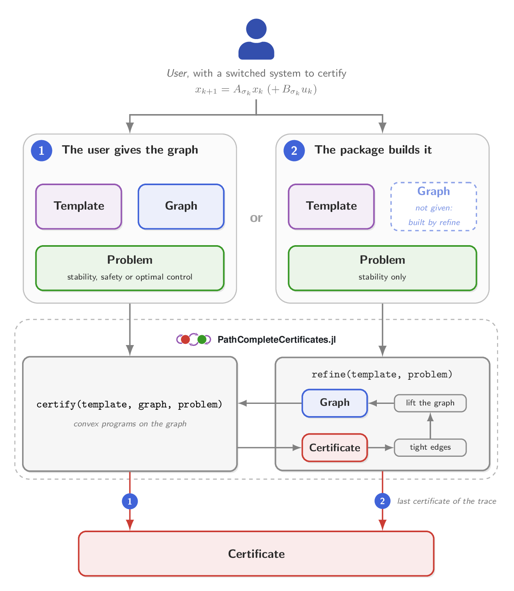

<picture>
  <source media="(prefers-color-scheme: dark)" srcset="docs/src/assets/banner-dark.svg">
  
</picture>

| **Documentation** | **Build Status** |
|:-----------------:|:----------------:|
| [![][docs-latest-img]][docs-latest-url] | [![Build Status][build-img]][build-url] [![Codecov][codecov-img]][codecov-url] [![Aqua QA][aqua-img]][aqua-url] |

[docs-latest-img]: https://img.shields.io/badge/docs-latest-blue.svg
[docs-latest-url]: https://dionysos-dev.github.io/PathCompleteCertificates.jl/dev

[build-img]: https://github.com/dionysos-dev/PathCompleteCertificates.jl/actions/workflows/ci.yml/badge.svg?branch=master
[build-url]: https://github.com/dionysos-dev/PathCompleteCertificates.jl/actions?query=workflow%3ACI
[codecov-img]: https://codecov.io/github/dionysos-dev/PathCompleteCertificates.jl/branch/master/graph/badge.svg
[codecov-url]: https://app.codecov.io/github/dionysos-dev/PathCompleteCertificates.jl
[aqua-img]: https://juliatesting.github.io/Aqua.jl/dev/assets/badge.svg
[aqua-url]: https://github.com/JuliaTesting/Aqua.jl

<!-- Deliberately absent until they would mean something: a `docs-stable` badge,
     since there is no released version, and PkgEval, whose report only exists
     once the package is in the General registry. Add both at registration. -->

PathCompleteCertificates.jl is a [Julia](https://julialang.org/) package that computes
certificates for **discrete-time switched linear systems** under arbitrary switching: proofs
that the system is stable, that it stays safe, or that a feedback policy keeps its cost
bounded. Each certificate is built on a path-complete graph, a graph whose paths read every
sequence of modes. You choose the graph, or let the package build it:

<p align="center">
  
</p>

## A basic example

We certify the stability of a planar switched linear system with two modes. We take the
quadratic template and the simplest graph: one node, with a self-loop for each mode. Together
they give a common quadratic Lyapunov function, whose rate is an upper bound on the joint
spectral radius:

```julia
import PathCompleteCertificates as PCC
import Clarabel

A1 = [0.1552 0.0447; 0.7641 0.7472]     # mode 1
A2 = [0.0475 0.9176; 0.1896 0.0185]     # mode 2
system = PCC.switched_system([A1, A2])  # planar switched linear system, two modes

certificate = PCC.certify(
    PCC.QuadraticTemplate(),         # V(x) = xᵀPx at each node
    PCC.common_graph(system),        # one node, one loop per mode
    PCC.StabilityProblem(system);    # V(Aᵢx) ≤ γ² V(x) along each edge
    optimizer = Clarabel.Optimizer,  # the solver of the semidefinite program
)
certificate.rate                     # 0.9587: below one, the system is stable
```

## Installation

The package is not registered yet. Install it, and a solver, from the Julia REPL:

```julia
import Pkg
Pkg.add(url = "https://github.com/dionysos-dev/PathCompleteCertificates.jl")
Pkg.add("Clarabel")
```

## Documentation

The [documentation](https://dionysos-dev.github.io/PathCompleteCertificates.jl/dev/) has a
manual, one tutorial per use case, the API reference and the developer guide.
[Should you use it?](https://dionysos-dev.github.io/PathCompleteCertificates.jl/dev/should_i_use/)
says what the package does and does not cover, and which other tools to use instead.

## Contributing

Contributions are welcome: open an
[issue](https://github.com/dionysos-dev/PathCompleteCertificates.jl/issues) to report a bug or
discuss a feature.

The package aims to implement the state of the art on path-complete certificates.
[What works with what](https://dionysos-dev.github.io/PathCompleteCertificates.jl/dev/manual/support/)
lists the gaps, and
[Extending the package](https://dionysos-dev.github.io/PathCompleteCertificates.jl/dev/developers/extending/)
says how to close one, with a new template, problem, lift or refinement algorithm.

## Citing

A paper describing the package is in preparation; until it is published, cite this
repository. For the algorithms and theoretical results the package implements, cite the papers
they come from, listed in the
[Bibliography](https://dionysos-dev.github.io/PathCompleteCertificates.jl/dev/bibliography/).

## License

PathCompleteCertificates.jl is licensed under the [MIT license](LICENSE).

## Acknowledgements

This project has received funding from the European Research Council (ERC) under the European
Union's Horizon 2020 research and innovation programme under grant agreement No 864017 (L2C).
