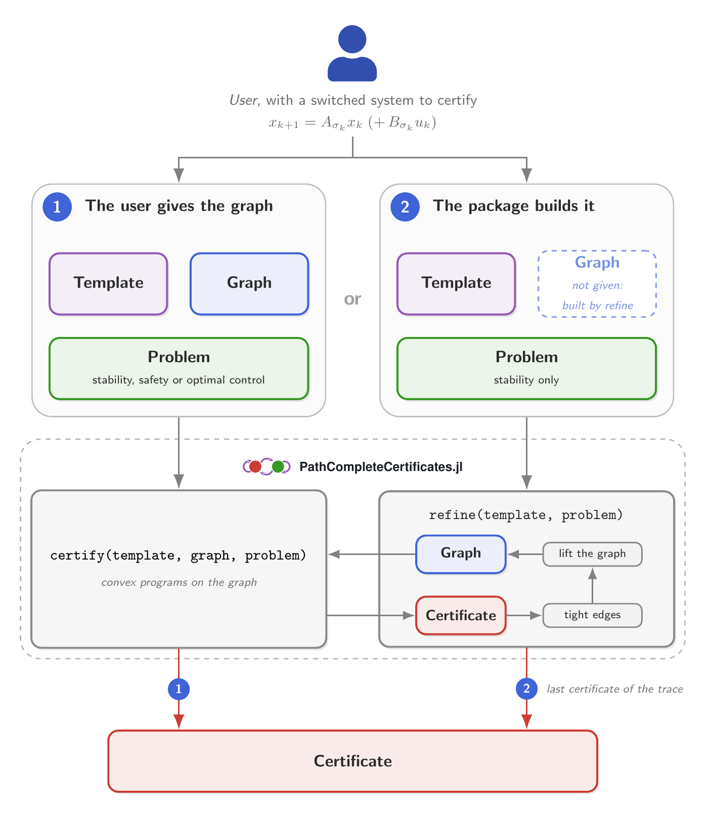

```@meta
CurrentModule = PathCompleteCertificates
```

# PathCompleteCertificates.jl

PathCompleteCertificates.jl is a [Julia](https://julialang.org/) package that
computes certificates for **discrete-time switched linear systems** under
arbitrary switching: proofs that the system is stable, that it stays safe, or
that a feedback policy has a bounded worst-case cost. Each certificate is
built on a path-complete graph, a graph whose paths read every sequence of
modes. You choose the graph, or let the package build it.

## What it certifies

- **Stability.** An upper bound on the joint spectral radius, the worst
  asymptotic growth rate of the trajectories. A bound below one proves the
  system stable.
- **Safety.** That no trajectory starting in an initial set reaches an unsafe
  set.
- **Optimal control.** A state-feedback policy, and an upper bound on its
  worst-case cost over the switching sequences.

## Two ways to use it

[`certify`](@ref) takes three independent arguments: the **problem** says
what is certified, the **template** gives the family of the node functions,
and the **graph** carries one node function per node and one edge inequality
per edge. Changing one of them is a one-line change. The graph is either
given or built:

1. You give the graph, and [`certify`](@ref) computes a certificate on it, for
   any of the three problems.
2. Or, for stability, you leave the graph out, and [`refine`](@ref) builds
   one: it solves, reads where the certificate is tight, lifts the graph
   there, and solves again. It returns every graph and certificate of the
   run, and the last certificate has the best bound.

```@raw html
<p style="text-align: center;">
  
</p>
```

## An example

The simplest case of the first way takes a planar switched linear system with
two modes, ``x_{k+1} = A_{\sigma(k)} x_k``, the quadratic template
``V(x) = x^\top P x``, and the common graph, with one node. Together they give
a stability certificate, a common quadratic Lyapunov function, whose rate
``\gamma`` is an upper bound on the joint spectral radius of the system:

```@example
using PathCompleteCertificates
import Clarabel

A1 = [0.1552 0.0447; 0.7641 0.7472]     # mode 1
A2 = [0.0475 0.9176; 0.1896 0.0185]     # mode 2
system = switched_system([A1, A2])      # planar switched linear system, two modes

certificate = certify(
    QuadraticTemplate(),             # V(x) = xᵀPx at each node
    common_graph(system),            # one node, one loop per mode
    StabilityProblem(system);        # V(Aᵢx) ≤ γ² V(x) along each edge
    optimizer = Clarabel.Optimizer,  # the solver of the semidefinite program
)
certificate.rate
```

The bound is below one, so the system is stable under arbitrary switching.

[How a certificate works](@ref) explains the optimization problem that the
template, the graph and the problem build, and why its solution proves
stability, safety or a bound on the cost, for every switching sequence.

## How the documentation is structured

New to the package? Read [Should you use PathCompleteCertificates.jl?](@ref)
and [Installation](@ref), then Part I of the manual.

- **Manual.** How to solve your problem with the package, in three parts, the
  first two following the two ways above:
  - **I. Certify your system with a graph you choose.** Define the system and
    the problem, choose a template and a graph, call [`certify`](@ref), and
    read the certificate. Start at [Systems and problems](@ref).
  - **II. Let the package improve the graph.** When you do not know which
    graph to choose, or want a better certificate,
    [Refining the graph](@ref) improves it step by step, applying
    [Lifts](@ref) where the certificate is tight. The lifts it applies,
    splits and products, are valid for every template, so each step gives a
    certificate at least as good.
  - **III. Going further.** Tools on the framework itself, beyond one system:
    [Comparing graphs](@ref), to prove when possible that a graph gives a
    certificate at least as good as another for every system, and
    [Duality](@ref), which reverses the graph, transposes the system, and,
    for stability, turns a certificate into another just as good.

  [What works with what](@ref) says which templates each problem accepts, and
  with which program, which lifts are valid for each template, where
  refinement and comparison apply, and which gaps remain.
- **Tutorials.** One problem solved from start to end per page.
- **Bibliography.** The papers the package implements, and what it takes
  from each.
- **API Reference.** Every function, from its docstring.
- **Developers.** How to set up, test and extend the package.

## For researchers

The package aims to implement the state of the art on path-complete
certificates, and its documentation to survey the literature behind it:
results spread across many papers, brought together in one implementation and
one notation. The manual cites, where each result is used, the paper and the
theorem it comes from, and the [Bibliography](@ref) says which paper each part
of the package comes from.

Since every template, graph and problem shares one interface, methods from
different papers run on the same system with the same solver, and their
conservativeness and solve time can be benchmarked side by side.

To keep the implementation and the survey current, the package is built to
receive new methods:
[What works with what](@ref) shows the combinations not yet covered, and
[Extending the package](@ref) how to add a template, a problem, a lift or a
refinement algorithm.

## Getting help

For questions, bug reports and suggestions, open an issue on
[GitHub](https://github.com/dionysos-dev/PathCompleteCertificates.jl/issues).

## Citing

The package and the methods it implements are cited separately:

- **The package.** If you use PathCompleteCertificates.jl in your work, please
  cite it. A paper describing the package is in preparation. Until it is
  published, cite the
  [GitHub repository](https://github.com/dionysos-dev/PathCompleteCertificates.jl).
- **The methods.** For the algorithms and theoretical results the package
  implements, please cite the papers they come from, listed in the
  [Bibliography](@ref).

## License

PathCompleteCertificates.jl is licensed under the
[MIT license](https://github.com/dionysos-dev/PathCompleteCertificates.jl/blob/master/LICENSE).
It is used with solvers and other packages that have their own licenses.
Consult their repositories for the licenses that apply.
