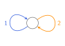

```@meta
CurrentModule = PathCompleteCertificates
```

# PathCompleteCertificates.jl

PathCompleteCertificates.jl is a [Julia](https://julialang.org/) package that
computes certificates for **discrete-time switched linear systems** under
arbitrary switching: proofs that the system is stable, that it stays safe, or
that a feedback policy keeps its cost bounded. Each certificate is built on a
path-complete graph, a graph whose paths read every sequence of modes. You
choose the graph, or let the package build it.

## What it certifies

- **Stability.** An upper bound on the joint spectral radius, the worst
  asymptotic growth rate of the trajectories. A bound below one proves the
  system stable.
- **Safety.** That no trajectory starting in an initial set reaches an unsafe
  set.
- **Optimal control.** A state-feedback policy, and an upper bound on its
  worst-case cost over all switching sequences.

## Two ways to use it

You give the graph, and [`certify`](@ref) computes a certificate on it, for
any of the three problems. Or, for stability, [`refine`](@ref) builds a
graph adapted to the system, iteratively: it alternates between computing a
certificate and improving the graph.

```@raw html
<p style="text-align: center;">
  
</p>
```

## A basic example

We certify the stability of a planar switched linear system with two modes,
``x_{k+1} = A_{\sigma(k)} x_k`` with ``\sigma(k) \in \{1, 2\}``. We take the
quadratic template, ``V(x) = x^\top P x``, and the simplest graph: one node,
with a self-loop for each mode.

```@raw html
<p style="text-align: center;">
  
</p>
```

Together they give a common quadratic Lyapunov function, whose rate
``\gamma`` is an upper bound on the joint spectral radius of the system:

```@example home
import PathCompleteCertificates as PCC
import Clarabel

A1 = [0.1552 0.0447; 0.7641 0.7472]     # mode 1
A2 = [0.0475 0.9176; 0.1896 0.0185]     # mode 2
system = PCC.switched_system([A1, A2])  # planar switched linear system, two modes

certificate = PCC.certify(
    PCC.QuadraticTemplate(),         # V(x) = xᵀPx at each node
    PCC.common_graph(system),        # one node, a self-loop per mode
    PCC.StabilityProblem(system);    # V(Aᵢx) ≤ γ² V(x) along each edge
    optimizer = Clarabel.Optimizer,  # the solver of the semidefinite program
)
certificate.rate
```

The bound is below one, so the system is stable under arbitrary switching.

[How a certificate works](@ref) explains the optimization program that the
template, the graph and the problem build, and why its solution proves
stability, safety or a bound on the worst-case cost over all switching
sequences.

## How the documentation is structured

If you are new to the package, start with
[Should you use PathCompleteCertificates.jl?](@ref) and [Installation](@ref),
then read Part I of the manual.

- **Manual.** How to solve your problem with the package, in three parts:
  - **I. Certify your system with a graph you choose.** Define the system and
    the problem, that is, the guarantee you want (stability, safety or
    optimal control), choose a template and a graph, call [`certify`](@ref), and
    read the certificate. Start at [Systems and problems](@ref).
  - **II. Let the package improve the graph.** When you do not know which
    graph to choose, or want a better certificate,
    [Refining the graph](@ref) improves it step by step with
    [Lifts](@ref), operations on the graph that each give a certificate at
    least as good.
  - **III. Going further.** [Comparing graphs](@ref) proves, when possible,
    that a graph gives a certificate at least as good as another for every
    system. [Duality](@ref) turns a certificate into another one, on the
    reversed graph, for the transposed system.

  [What works with what](@ref) says which templates each problem accepts,
  which lifts are valid for each template, where refinement and comparison
  apply, and which gaps remain.
- **Tutorials.** One problem solved from start to end per page.
- **Bibliography.** The papers the package implements, and what it takes
  from each.
- **API Reference.** Every function, from its docstring.
- **Developers.** How to set up, test and extend the package.

## For researchers

The package aims to implement the state of the art on path-complete
certificates. The manual cites, where each result is used, the paper and the
theorem it comes from; the [Bibliography](@ref) says what the package takes from each
paper. Every template, graph and problem shares one interface, so methods from
different papers run on the same system with the same solver.
[What works with what](@ref) lists the combinations not yet covered, and
[Extending the package](@ref) explains how to add one.

## Getting help

For questions, bug reports and suggestions, open an issue on
[GitHub](https://github.com/dionysos-dev/PathCompleteCertificates.jl/issues).

## Citing

The package and the methods it implements are cited separately:

- **The package.** If you use PathCompleteCertificates.jl in your work, please
  cite it. A paper describing the package is in preparation; until it is
  published, cite the
  [GitHub repository](https://github.com/dionysos-dev/PathCompleteCertificates.jl).
- **The methods.** For the algorithms and theoretical results the package
  implements, please cite the papers they come from, listed in the
  [Bibliography](@ref).

## License

PathCompleteCertificates.jl is licensed under the
[MIT license](https://github.com/dionysos-dev/PathCompleteCertificates.jl/blob/master/LICENSE).
It is used with solvers and other packages that have their own licenses;
consult their repositories for the licenses that apply.
